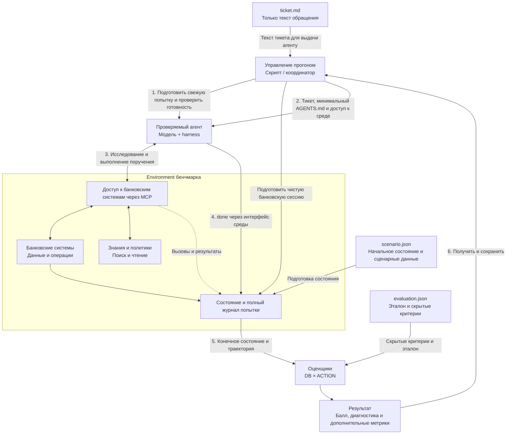

# Архитектура банковского бенчмарка

Верхнеуровневая схема взаимодействия проверяемого агента и Banking.ru.
Обновлено 28 октября 2026 года. Цели и правила — в [общем концепте](../banking-ru.md).

Это принятая целевая схема, а не утверждение, что все проверки и интерфейсы
уже реализованы. Таблица ниже связывает компоненты с текущими исходниками;
детализация новых API и проверки готовности остаётся следующей работой.

## Компоненты

| Компонент | Ответственность |
|---|---|
| Управление прогоном | Подготавливает попытку, запускает или подключает агента, проверяет готовность, выдаёт тикет и собирает результат |
| Проверяемый агент | Модель и её harness: получает задачу, исследует доступную среду, выбирает и выполняет действия |
| Тикет | Отдельный файл только с текстом обращения; его содержание получает агент |
| Сценарий | Отдельный файл с начальным банковским состоянием и сценарными данными; используется средой |
| Контракт оценки | Отдельный файл с эталоном и критериями DB и ACTION; используется оценщиком |
| Environment бенчмарка | Предоставляет банковские системы через MCP, знания и политики, состояние и журнал одной попытки |
| Оценщики | Проверяют конечное состояние и траекторию; возвращают DB × ACTION и диагностику |

### Где читать о компонентах

| Компонент | Документация | Где смотреть текущую реализацию |
|---|---|---|
| Управление банковским прогоном | [Разработка и модельные эксперименты](development.md) | [run_codex_harness.py](../../scripts/banking_ru/run_codex_harness.py), [banking_preflight.py](../../scripts/banking_ru/banking_preflight.py) |
| Проверяемый агент: вход, контекст и ограничения | [Как задача выглядит для агента](../banking-ru.md#как-задача-выглядит-для-агента) | [Запуск в контейнере](../../scripts/banking_ru/codex_container.py) |
| Агенты, встроенные в τ-bench | [Устройство агентов](../../src/tau2/agent/README.md), [базовые интерфейсы](../../src/tau2/agent/base/README.md) | [src/tau2/agent/](../../src/tau2/agent/) |
| Общий runner τ-bench | [Запуск симуляций](../running_simulations.md), [слои runner](../../src/tau2/runner/README.md) | [src/tau2/runner/](../../src/tau2/runner/) |
| Тикет, сценарий и контракт оценки | [Формат задачи](task-format.md), [раздельные файлы задания](#раздельные-файлы-задания) | [task_store.py](../../src/tau2/domains/banking_ru/task_store.py), [схема Task](../../src/tau2/data_model/tasks.py) |
| Environment и банковские системы | [Общая среда](../banking-ru.md#общая-среда-и-выполнение-поручения), [данные домена](../../data/tau2/domains/banking_ru/README.md) | [environment.py](../../src/tau2/domains/banking_ru/environment.py), [mcp_systems.py](../../src/tau2/domains/banking_ru/mcp_systems.py) |
| Каталог MCP и вызовы | [Контракт bank_directory и bank_call](discovery.md) | [Каталог и валидация](../../src/tau2/platform/bank_directory.py), [MCP-сессия](../../src/tau2/platform/session.py) |
| Знания и политики | [Контракт knowledge MCP](knowledge.md), [правила источников](../banking-ru.md#знания-и-политики) | [file_corpus.py](../../src/tau2/domains/banking_ru/file_corpus.py), [corpus_manifest.py](../../src/tau2/domains/banking_ru/corpus_manifest.py) |
| Состояние, журнал и завершение | [Порядок попытки](#порядок-одной-попытки), [текущий механизм оценки](../banking-ru.md#как-работает-текущий-оценщик) | [session.py](../../src/tau2/platform/session.py), [mcp_transport.py](../../src/tau2/platform/mcp_transport.py) |
| Оценщики и результат | [Банковская оценка](evaluation.md), [общие механизмы τ-bench](../evaluation.md) | [evaluator.py](../../src/tau2/evaluator/evaluator.py), [сохранение результатов платформы](../../src/tau2/platform/service.py) |

Внешний Codex harness банковского прогона и встроенные агенты τ-bench — разные
способы подключения проверяемого агента. Документация общего runner не заменяет
банковские правила запуска и изоляции. Для проверки чистоты и готовности пока нет
отдельного реализованного контракта: выше даны ссылки на постановку и текущий код,
а не подтверждение наличия таких проверок. Поддерживаемый запуск описан в
процессе разработки. Формат трёх файлов реализован для Bank 2, Bank 40 и Bank 41; остальные 58 задач сохраняют
прежнее хранение. Общая модель `Task` и интерфейс выдачи тикета сохранены.

## Общая схема

Знания и политики доступны через среду, но заранее не загружаются в контекст
модели. Как именно организованы поиск и чтение, на этой схеме не фиксируется.

## Раздельные файлы задания

Целевое хранение разделяет три файла, связанные ID задания на стороне платформы:

| Файл | Содержание | Кто использует |
|---|---|---|
| `ticket.md` | Только текст обращения клиента, без начального состояния, критериев и эталона | Агент получает текст файла |
| `scenario.json` | Начальное состояние и сценарные данные | Среда при подготовке попытки |
| `evaluation.json` | Эталон, критерии DB и ACTION и допустимые результаты | Оценщик |

Из файлов конкретного задания агент получает только текст тикета. Общий startup
и доступ к MCP предоставляются отдельно. Банковские данные агент получает через
разрешённые инструменты, а не чтением `scenario.json`.

Разделение файлов не заменяет изоляцию: сценарий и контракт оценки не передаются
в агентский каталог, корпус, результаты поиска или доступные ему файловые каналы.
Служебные связи файлов остаются на стороне платформы. Размещение и правила сборки реализованного формата описаны
в [формате задачи](task-format.md#целевое-разделение-файлов).

Сейчас Bank 2, Bank 40 и Bank 41 хранятся в каталогах `tasks/bank_002/`,
`tasks/bank_040/`, `tasks/bank_041/` с тремя файлами каждый.
Индекс указывает на `scenario.json`; загрузчик собирает прежний `Task`.
Остальные 58 задач остаются в `tasks/bank_*.json`. Содержание и оценка
разделённых задач при переносе не изменены.

## Порядок одной попытки

1. **Подготовить чистый запуск.** Создать новую агентскую сессию без истории
   прежних попыток, восстановленных диалогов и артефактов предыдущих решений.
   Подготовить отдельную банковскую сессию с начальным состоянием выбранной задачи.
2. **Проверить готовность.** Убедиться, что запущенный агент отвечает и способен
   принять задачу. Проверка не содержит тикета, решения или предметных подсказок.
   Точный протокол проверки ещё предстоит определить.
3. **Выдать задачу.** Передать только текст `ticket.md` и минимальную общую
   инструкцию, предоставить разрешённый доступ к среде. Файлы сценария и оценки,
   эталон, исходники оценщика и прошлые траектории агенту не передаются.
4. **Выполнить поручение.** Агент самостоятельно находит системы, инструменты,
   знания и политики, получает результаты и выполняет банковские действия.
   Среда сохраняет вызовы, исходные аргументы, результаты и порядок событий.
5. **Завершить.** Агент вызывает `done`. Это конец попытки, а не доказательство
   правильного решения. Лимит, внешнее прерывание и технический сбой имеют
   отдельную причину завершения.
6. **Оценить и сохранить.** Оценщики применяют скрытый контракт к конечному
   состоянию и полному журналу. Управление прогоном сохраняет балл, компоненты,
   диагностику, дополнительные метрики и версию входов.

Чистота относится к изоляции и контексту конкретной попытки: агенту не подмешиваются
прошлые сессии, память и результаты. Она не доказывает, что базовая модель никогда
не встречала похожую задачу при обучении. Готовность агента и чистота контекста —
разные проверки; ответ на проверку готовности не доказывает отсутствие истории.

## Доступ к среде

В [контракте discovery](discovery.md) зафиксированы `bank_directory`,
постепенное раскрытие инструментов и общий `bank_call`. На старте модели
доступны схемы этих двух инструментов; каталоги и схемы операций открываются
по запросу. Интерфейс реализован в выбираемом режиме платформы `directory`;
существующий модельный preflight остаётся в `systems` до отдельной проверки. На верхнем уровне это интерфейс между агентом и MCP
банковских систем. Конкретный способ передачи доступа при запуске ещё нужно
описать: что получает harness, что видит модель и как связывается одна попытка
с соответствующей банковской сессией.

Для знаний и политик согласован [контракт knowledge MCP](knowledge.md): каталог,
редакции, даты, отдельное чтение и команды ls/find/grep/cat внутри виртуального
корпуса. grep возвращает только совпадения; cat и read_document — полный текст.
Реализация и миграция текущих операций ещё предстоят. Доступ не раскрывает
файлы хоста, эталоны или скрытые материалы бенчмарка.

## Что уточняем дальше

- Проверяемый контракт свежей агентской сессии и критерии готовности.
- Техническую передачу MCP-доступа агентскому harness; начальные инструменты
  модели уже определены контрактом discovery.
- Реализацию согласованного knowledge MCP и проверку миграции источников;
  числовые лимиты выдачи grep и discovery остаются открытыми.
- Отображение этих компонентов на текущую реализацию и необходимые изменения.

Дополнительные участники процесса на этой схеме не показаны; это упрощение
архитектурного представления не удаляет существующие инструменты или данные.

Схема продолжает верхнеуровневое описание из Wiki
«Банковский домен — схема работы агента». Исторические API и старые формулы
оценки не переносятся как требования. Здесь показан целевой DB × ACTION;
фактический статус миграции задач указан в [концепте](../banking-ru.md).
